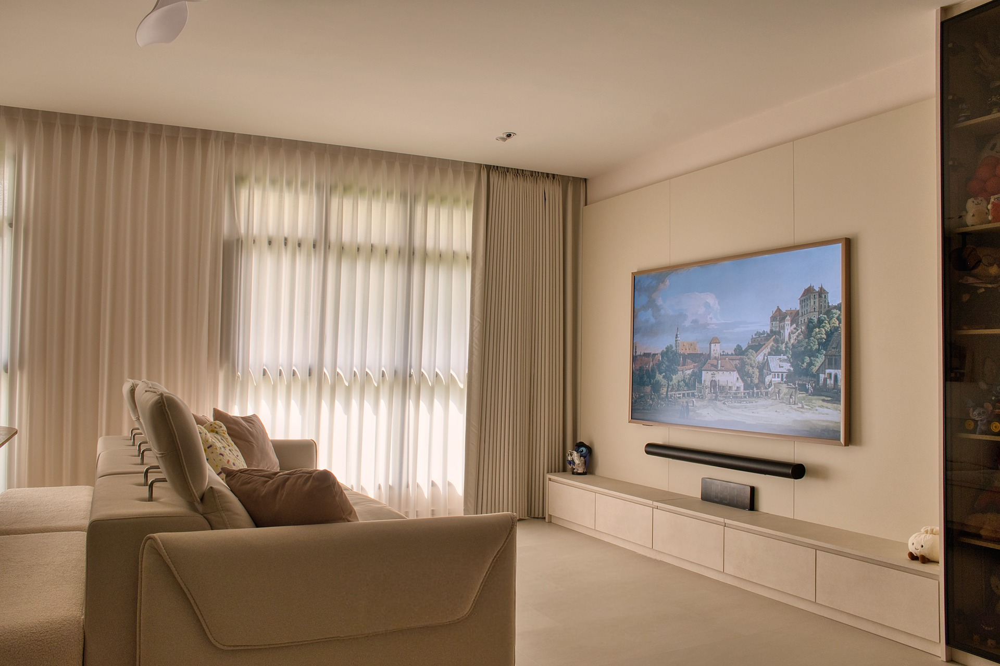

# Hero Banner Archive & Revert Guide

This document records the historical hero banner configurations for LuxCraft homepage (`public_html/index.html`), allowing quick reference and one-step restoration if you ever wish to revert.

---

## 1. Hero Slide 0 (First Banner)

### Original Configuration: Champions Way Kitchen (Archived 21 Sep 2026)
- **Subject**: Champions Way kitchen renovation with modern pendant lights, wooden cabinetry, and quartz countertop.
- **Linked Project**: `/portfolio-pages/champions-way`
- **Image Files**:
  - Original backup: `public_html/assets/images/Hero-1.jpg.bak`
  - Named backup: `public_html/assets/images/Hero-1-champions-way-original.jpg`
- **Original HTML Markup**:
```html
          <article aria-hidden="false"
            class="hero-slide hero-slide--active hero-slide--copy-visible absolute inset-0 flex h-full w-full flex-col justify-center overflow-hidden opacity-0 transition-opacity duration-700"
            data-hero-slide="0">
            
            <div class="absolute inset-0 bg-gradient-to-tr from-black/80 via-black/60 to-transparent"></div>
            <div class="hero-copy">
              <span class="hero-kicker">Interior Trends</span>
              <h1 class="hero-headline">
                Interior Design &amp; Renovation
                <span class="block text-2xl sm:text-3xl font-light text-[#BF9C65] tracking-wide mt-2">Crafted for Singapore Homes</span>
              </h1>
              <p class="hero-subcopy">
                Discover stylish, functional interior design in Singapore. From <a
                  href="/services-pages/hdb-bto-sbf-renovation"
                  class="!text-white font-bold underline hover:text-[#BF9C65] transition-colors">BTO</a> and <a
                  href="/services-pages/hdb-resale-renovation"
                  class="!text-white font-bold underline hover:text-[#BF9C65] transition-colors">resale HDBs</a> to <a
                  href="/services-pages/condo-renovation"
                  class="!text-white font-bold underline hover:text-[#BF9C65] transition-colors">luxury condo
                  renovations</a>, LuxCraft delivers concept to completion with meticulous project management.
              </p>
              <div class="hero-actions">
                <a class="hero-button hero-button--ghost" href="/contact">Book a Consultation</a>
                <a class="hero-button hero-button--ghost hero-button--project group" href="/portfolio-pages/champions-way">
                  <span>Check out this project</span>
                  <svg class="h-4 w-4 shrink-0 transition-transform duration-200 group-hover:translate-x-0.5 group-hover:-translate-y-0.5" fill="none" stroke="currentColor" stroke-width="2" viewBox="0 0 24 24" aria-hidden="true">
                    <path stroke-linecap="round" stroke-linejoin="round" d="M7 17L17 7M7 7h10v10" />
                  </svg>
                </a>
              </div>
            </div>
          </article>
```

#### Steps to Revert Slide 0:
1. Copy `public_html/assets/images/Hero-1-champions-way-original.jpg` back to `public_html/assets/images/Hero-1.jpg`.
2. In `public_html/index.html`, replace `<article ... data-hero-slide="0">` with the HTML snippet above.

---

### Active Configuration: 967B Tampines St 96 Living Room (Updated 21 Sep 2026)
- **Subject**: Modern Japandi living room featuring built-in media console, Samsung Frame TV with art display, sheer drapery, and warm ambient illumination.
- **Linked Project**: `/portfolio-pages/967b-tampines-st-96`
- **Image Files**:
  - `public_html/assets/images/Hero-1.webp` (Full HD WebP, 1920x1280)
  - `public_html/assets/images/Hero-1@2x.webp` (Retina 4K WebP, 2560x1707)
  - `public_html/assets/images/Hero-1.jpg` (Full HD Progressive JPEG fallback)
  - Source raw: `raw/pf22-967B-Tampines-raw/landscape-2.jpeg` (6240x4160)
